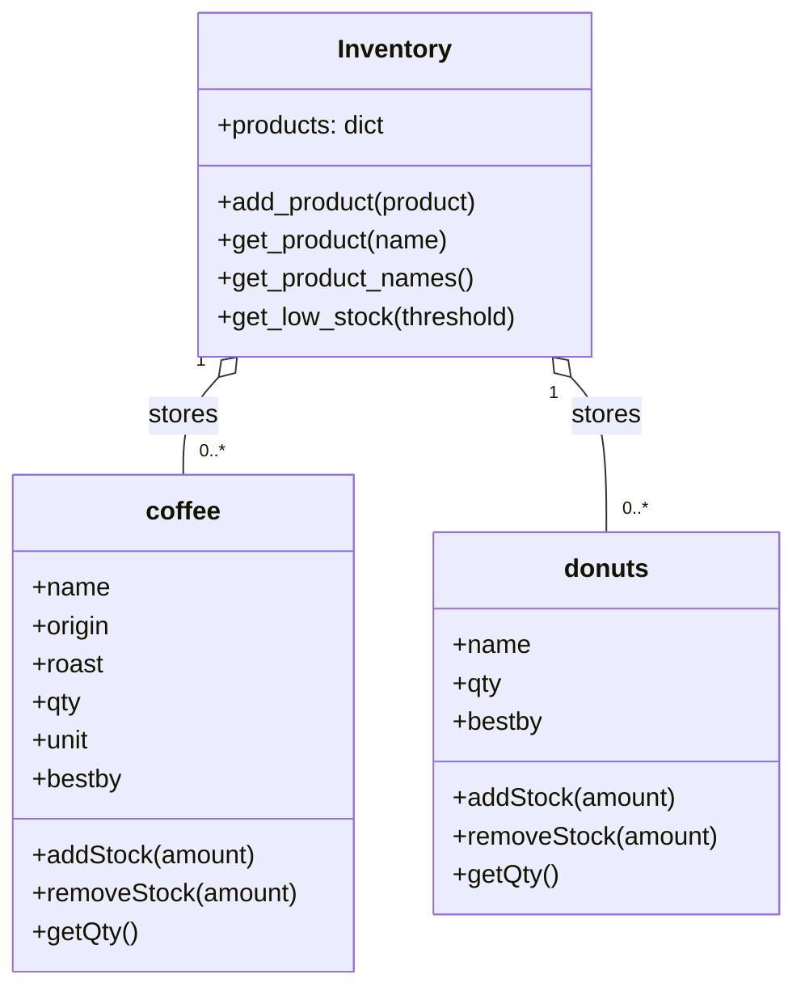

# Coffee Shop Inventory

Coffee shop inventory, a python based desktop app
to track coffee shop inventory. Two sample product types
are used, coffee and donuts, but more can be added by
the user.

This app includes low stock alerts, a filterable table
to display product types and a simple crud interface.

this app requires, tkinter, and TTKBootStrap, make 
sure both are installed and avaialble in the 
environment. To launch `python3 gui.py`

## Class Diagram

`Inventory` stores coffee and donut product objects, and each product manages its own stock quantity.
